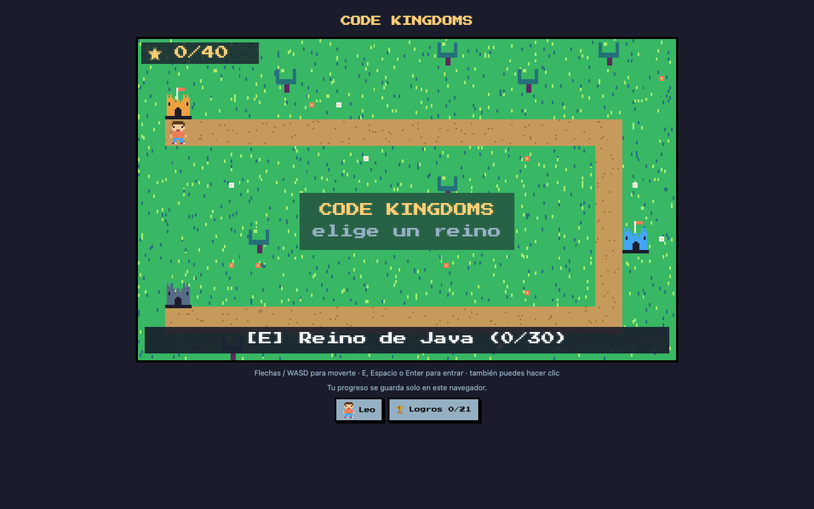
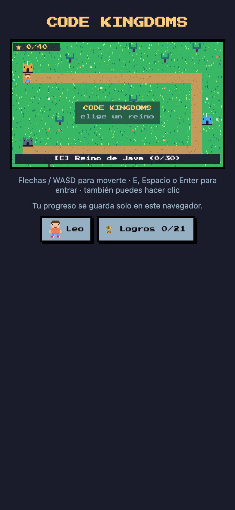

# Code Kingdoms

A 2D pixel-art game for learning programming languages and the cloud. Start on an overworld of castles, pick a kingdom (Java, Cloud…), then a world, and work through it part by part (1-1, 1-2, 1-3) by solving short coding challenges.

## Screenshots



<p align="center"></p>

> 🇪🇸 [Leer en español](README.es.md)

> **Status:** in development. Being built from two earlier standalone games, Java Quest and Cloud Quest.

## What you will be able to do

| Feature | Description |
|---------|-------------|
| Overworld | A map of castles, one per kingdom. Locked castles show what's coming next. |
| Worlds and parts | Each kingdom has worlds (1, 2, 3…) and each world is split into parts (1-1, 1-2, 1-3). Clear one to unlock the next. |
| Java kingdom | 3 worlds, 30 levels: **Fundamentos** (variables, loops, arrays, methods), **Herramientas** (Strings, `switch`, `do-while`, 2D arrays) and **Objetos** (classes, constructors, encapsulation, inheritance). |
| Cloud kingdom | Type simulated AWS CLI commands (S3, IAM, EC2). Nothing reaches AWS and nothing costs money. |
| Achievements | Unlocked for clearing parts, finishing kingdoms, and more. |
| Leo, your character | Customize Leo with 3 hair, 3 shirt, 3 pants and 3 shoe styles. |
| Saved progress | Everything is saved in your browser (localStorage). |

## Quick path

```bash
bun install
bun run dev     # open the URL Vite prints
bun run test    # run the engine and game-logic tests
```

## Stack

| Topic | Decision |
|-------|----------|
| UI | React + Vite, as a static single-page app (no server) |
| Saving | `localStorage` behind a single save module, so it can move to a backend later |
| Hosting | Any static host (Cloudflare Pages, Vercel, Netlify) |
| Runtime | Bun (install and scripts) |
| Tests | Vitest, run with `bun run test` |

## Adding a new kingdom

Each kingdom is one module in `src/worlds/` that provides its levels, how they group into worlds (`chapters`) and parts (`partSizes`), and an engine that checks the player's answer. Register it and it shows up as a new castle on the overworld, with no other changes needed.

## Roadmap

- [x] Overworld, kingdoms and parts
- [x] Java and Cloud kingdoms migrated
- [x] Achievements
- [x] Character customization
- [x] Java with 3 worlds (30 levels)
- [ ] Deploy to a static host
- [ ] More worlds for Cloud
- [ ] Optional accounts and cloud saves to play with friends
